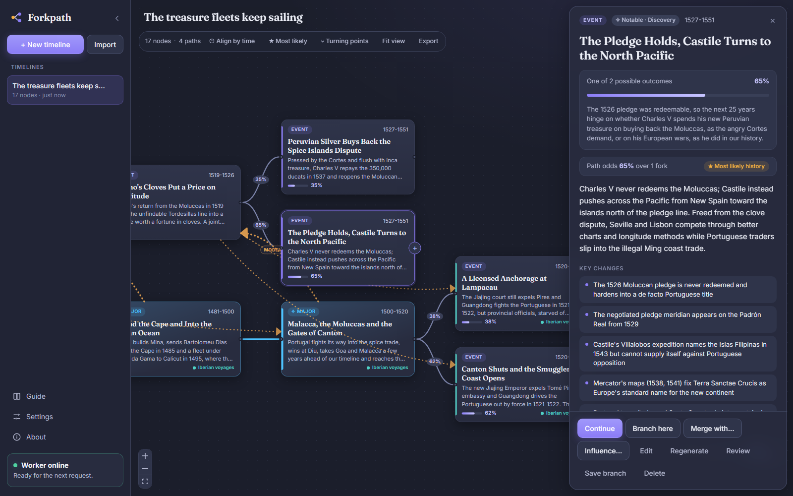
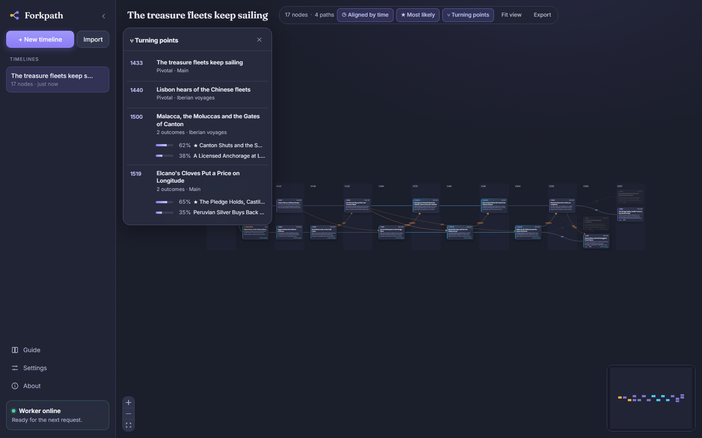
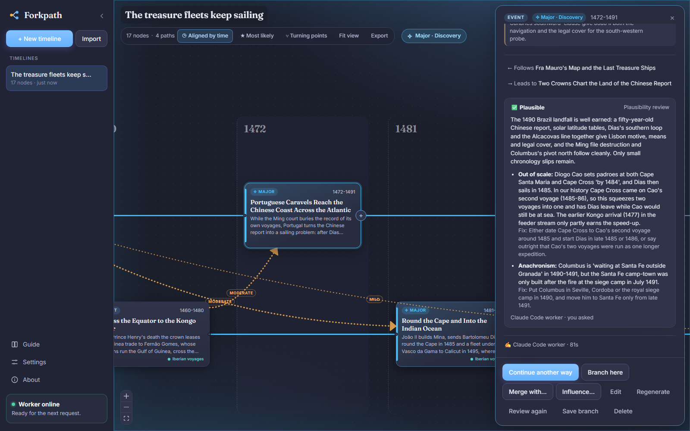
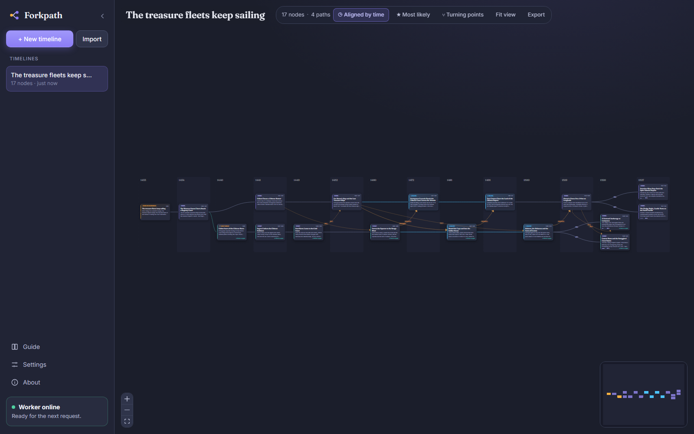
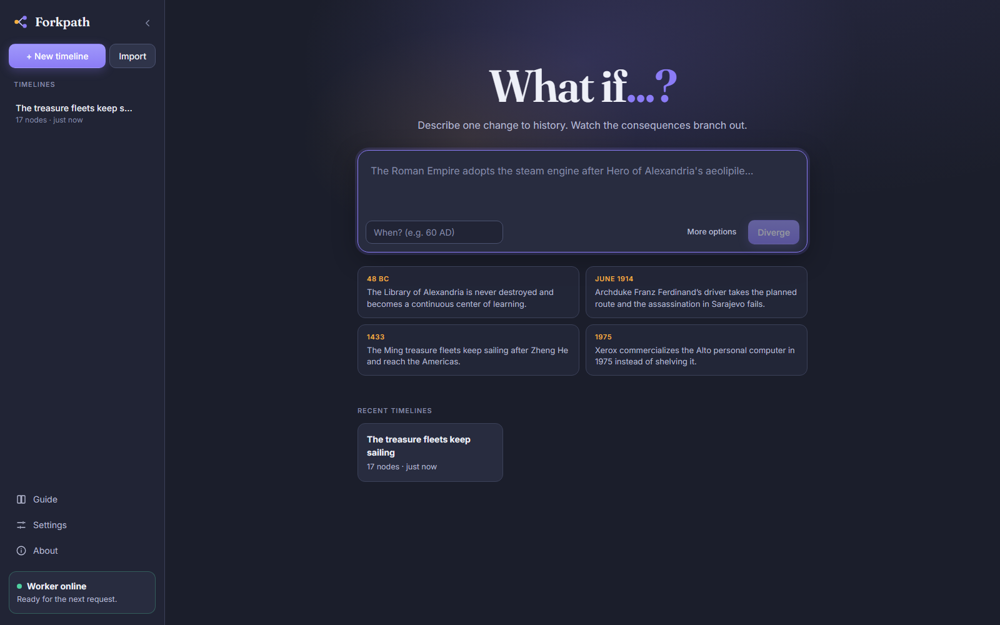

<p align="center">
  
</p>

<h1 align="center">Forkpath</h1>

<p align="center">
  <b>Change one moment in history. Watch the consequences branch out.</b><br />
  An AI writer maps what happens next, event by event, across parallel storylines,<br />
  with the odds at every fork. Runs on your machine; your timelines stay there.
</p>

<p align="center">
  
  
  
  <a href="LICENSE"></a>
</p>

<p align="center">
  <a href="docs/guide.md"><b>Guide</b></a> ·
  <a href="#getting-started"><b>Getting started</b></a> ·
  <a href="docs/engines.md">Engines and costs</a> ·
  <a href="docs/development.md">Development</a>
</p>



## Why Forkpath

Alternate history is usually told as one story. Real history is a tree of things that almost happened. Forkpath
keeps the whole tree:

- 🌳 **A map, not a story.** Every event is a node. The writer branches where outcomes are genuinely uncertain,
  gives each branch a likelihood, and tracks regions, wars and programs as parallel streams that influence and
  merge into each other.
- ⚖️ **Neutral as water.** Language models lean toward tidy, peaceful endings. Forkpath's writer runs a realism
  check (incentives, capabilities, historical base rates) before every event, and a separate review can flag
  unearned outcomes, anachronisms and numbers out of scale.
- ✍️ **You stay the author.** Edit, regenerate, branch or delete any event. Your edits become canon for
  everything after them, and the events they affect are marked stale.
- 🔌 **Your model, your machine.** Use a Claude Code session, or any Anthropic or OpenAI-compatible API,
  including local models in LM Studio or Ollama. No SDKs, no telemetry, timelines in plain JSON files.

## Features

| | |
|---|---|
| 🌱 **What if...?** | Describe one change and when it happens; the writer takes it from there |
| 🔀 **Branching with odds** | Alternatives with likelihoods, path odds for every event, and a **Most likely** view that fades every path history probably did not take |
| 🧵 **Parallel streams** | Threads for separate regions or programs, **Influence** links between them, **Merge** where storylines meet, and follow-up events the writer requests in other streams |
| ⑂ **Turning points** | Every fork and pivotal event in date order, with each outcome's share |
| 🔍 **Plausibility review** | On demand, or let the agent decide: a second writer checks an event and suggests fixes you can send straight to Regenerate |
| 🎛️ **Per-request control** | Time span, guidance, temperament (realist, grim, hopeful), narrative format (lossless beats or full story) |
| ◷ **Align by time** | Line up events from every branch by date |
| 🎨 **Mood theme** | Major and pivotal events recolor the app in their tone: conflict, catastrophe, discovery, diplomacy... |
| 💰 **Cost control** | Token and cost tracking, a monthly budget, prompt caching, and briefs that stay compact on long timelines |
| 💾 **Import and export** | Save a whole timeline or one branch; old files upgrade automatically |
| ⚡ **Scales** | Layout caching, viewport culling and a background layout worker keep thousand-node timelines smooth |

<table>
  <tr>
    <td></td>
    <td></td>
  </tr>
  <tr>
    <td></td>
    <td></td>
  </tr>
</table>

## Getting started

> [!IMPORTANT]
> Forkpath is in **alpha** (0.x). It is developed and tested on Windows; expect rough edges.

Requires **Node.js 22** or newer.

```bash
npm install
npm run dev
```

Open **http://localhost:5173**. Then pick what writes your history:

| Engine | Setup |
|---|---|
| 🤖 **Claude Code worker** (default) | Open a new Claude Code session in this folder and tell it: *"You are the Forkpath worker. Read `worker/WORKER.md` and follow it exactly. Start the job loop now and keep it running until I tell you to stop."* |
| 🔌 **Built-in model API** | **Settings** in the sidebar: pick a preset (Anthropic, OpenAI, Google Gemini, OpenRouter, Ollama, LM Studio), paste a key, **Test connection**, save |

The sidebar card at the bottom shows when the engine is ready. Details, every setting and what things cost:
[docs/engines.md](docs/engines.md).

> [!NOTE]
> Forkpath writes speculative fiction. Events, choices and numbers in a timeline are invented, and the model can
> be wrong about real history before the divergence. Edit anything that looks off, or ask for a review.

## Development

TypeScript end to end: React and React Flow in the browser, Express on the server, and the graph rules shared
between them.

```bash
npm run dev          # UI on :5173, API on :5174
npm run typecheck
npm test
npm run build        # then `npm start` serves everything on :5174
```

| Folder | What |
|---|---|
| [`web/`](web) | The UI (React 19, React Flow, dagre, Vite) |
| [`server/`](server) | The API, job queue, briefs, validation and the built-in model runner (Express, Zod) |
| [`shared/`](shared) | Types and graph rules used by both |
| [`worker/`](worker) | The Claude Code worker's job loop and commands |
| [`docs/`](docs) | Guide, engines and development notes |

See [docs/development.md](docs/development.md) for how a job flows, the file layout and the file format.

## License

[MIT](LICENSE), copyright (c) 2026 Srilal Siriwardhane.
